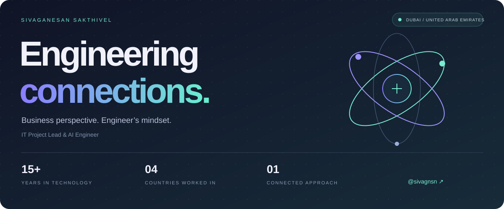

  

  <strong>IT Project Lead & AI Engineer · Dubai, UAE</strong> 
  Connecting business needs, enterprise platforms, and the people who use them.

  <a href="https://www.linkedin.com/in/sivaganesan-sakthivel-dev">LinkedIn</a> &nbsp; / &nbsp;
  <a href="mailto:sivaganesan.sakthivel@gmail.com">Email me</a> &nbsp; / &nbsp;
  <a href="https://github.com/sivagnsn?tab=repositories">Explore repositories</a>

---

### Hello, I’m Siva.

I turn complex business processes into connected, practical systems. My work spans **enterprise ERP delivery, AI automation, full-stack development, and IT operations** — with ownership from the first requirements conversation through launch and ongoing support.

I bring **15+ years in technology** across the UAE, Qatar, Tanzania, and India. At **AJ Al Asmawi Group**, I lead IT operations and enterprise delivery across a diverse group of businesses, and build custom applications and AI workflows where they can make everyday work easier.

### What I work on

| Focus | How I contribute |
| :--- | :--- |
| **AI & automation** | LLM integrations, retrieval-augmented generation, AI agents, document extraction, and workflow automation. |
| **Enterprise systems** | Odoo, Focus ERP, Oracle, and HRMS — process mapping, configuration, migration, testing, training, and go-live. |
| **Software engineering** | Business applications with React, Node.js, PHP, Laravel, and MySQL. |
| **Technology leadership** | Multi-location infrastructure, Microsoft 365, vendors, delivery teams, and business stakeholders. |

### Selected delivery

**01 / Connected manufacturing operations**  
Full-cycle Odoo implementation across **three group companies**, with manufacturing experience spanning metal, wood, food, and oil & gas. Work includes process mapping, customization, data migration, training, and post-launch support.

**02 / ERP across on-premise and cloud environments**  
Focus ERP delivery covering server setup, hosting, configuration, migration, user administration, upgrades, and functional support.

**03 / A stronger foundation for real estate**  
Oracle ERP deployment connecting property management, sales, financial processes, and compliance.

**04 / A connected employee lifecycle**  
Group-wide HRMS implementation covering payroll, recruitment, performance, and employee lifecycle management across subsidiaries.

These highlights describe professional delivery experience. Client systems and their source code may be private.

### My toolkit

**Build** &nbsp; React · Node.js · JavaScript · PHP · Laravel · MySQL  
**Automate** &nbsp; OpenAI · Claude · LLMs · RAG · AI agents · MCP  
**Connect** &nbsp; Odoo · Focus ERP · Oracle · HRMS  
**Operate** &nbsp; AWS · Azure · Microsoft 365 · Infrastructure & recovery

### How I approach delivery

- **Understand the process first.** Start with the people, constraints, and business need.
- **Connect the whole journey.** Keep requirements, implementation, training, and support aligned.
- **Stay close to the work.** Combine hands-on engineering with clear ownership and communication.

### Let’s connect

Interested in enterprise systems, practical AI, or a business application that needs to get built? I’m happy to talk.

**[sivaganesan.sakthivel@gmail.com](mailto:sivaganesan.sakthivel@gmail.com)** · **[LinkedIn](https://www.linkedin.com/in/sivaganesan-sakthivel-dev)**

Business perspective. Engineer’s mindset.

