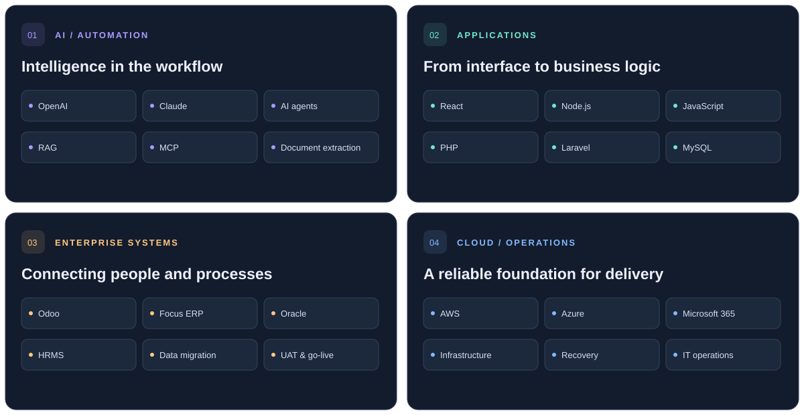

  

  
  
  

### I build the connections behind better business.

Hello, I’m **Siva** — an IT Project Lead & AI Engineer working where **business systems, software, and intelligent automation** meet. I turn complex processes into practical tools, and stay involved from requirements to rollout and support.

At **AJ Al Asmawi Group**, I lead IT operations and enterprise delivery across a diverse group of businesses. My experience spans **15+ years** across the **UAE, Qatar, Tanzania, and India**.

> **Understand the business. Connect the systems. Make the work easier.**

## The toolkit

  

<strong>Explore the stack by discipline</strong>

| Discipline | Tools & technologies | What I use them for |
| :--- | :--- | :--- |
| AI & automation | OpenAI · Claude · AI agents · RAG · MCP | LLM integrations, document extraction, and business workflows |
| Frontend | React · JavaScript · TypeScript · Next.js · Tailwind CSS | Business interfaces and web applications |
| Backend & data | Node.js · Express · PHP · Laravel · Python · FastAPI · MySQL · PostgreSQL · MongoDB | Services, integrations, APIs, and application data |
| Enterprise | Odoo · Focus ERP · Oracle · HRMS | Connected operations, migrations, and enterprise delivery |
| Cloud & DevOps | AWS · Azure · Google Cloud · Docker · Kubernetes · Terraform | Infrastructure and deployment workflows |
| Delivery tools | Git · GitHub Actions · Jenkins · Postman · Bash · PowerShell | Version control, automation, API testing, and operations |
| Other platforms | Flutter · Firebase · WordPress · Microsoft 365 | Mobile, digital platforms, and workplace systems |

## From business challenge to working system

| | Selected delivery | Scope |
| :--- | :--- | :--- |
| **01** | **Three companies. Connected operations.** | Full-cycle Odoo implementation: process mapping, customization, migration, training, and support. Manufacturing experience across metal, wood, food, and oil & gas. |
| **02** | **ERP across on-premise and cloud.** | Focus ERP delivery spanning server setup, hosting, migration, user administration, upgrades, and functional support. |
| **03** | **A stronger real estate foundation.** | Oracle ERP connecting property management, sales, financial processes, and compliance. |
| **04** | **One connected employee lifecycle.** | Group-wide HRMS covering payroll, recruitment, performance, and employee lifecycle management. |

Professional delivery highlights. Client systems and source code may be private.

## Built to explore

**[Digital business card + QR code ↗](https://github.com/sivagnsn/Digital-business-card-with-QR-code)**  
A PHP system for creating and sharing professional digital business cards.

**[JavaScript study playground ↗](https://github.com/sivagnsn/javascript_study_playground)**  
JavaScript concepts, experiments, and mini projects in one playground.

---

<strong>Have a process to improve or a platform to build?</strong> Let’s turn the next business challenge into a working solution.

<a href="mailto:sivaganesan.sakthivel@gmail.com">sivaganesan.sakthivel@gmail.com</a> &nbsp; · &nbsp; <a href="https://www.linkedin.com/in/sivaganesan-sakthivel-dev">LinkedIn ↗</a>

BUSINESS PERSPECTIVE / ENGINEER’S MINDSET

